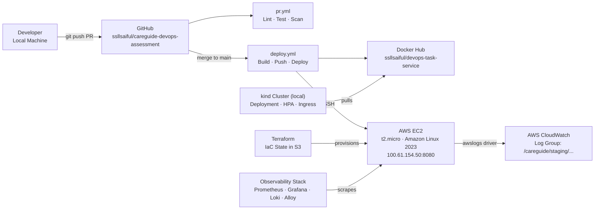

# CareGuide DevOps Assessment

> **Senior DevOps Engineer — Technical Assessment**  
> End-to-end production-grade DevOps stack: containerised FastAPI service with CI/CD, IaC, Kubernetes, observability, and automated health monitoring.

---

## Architecture Overview



---

## Assessment Steps — Completion Status

| # | Step | Status |
|---|------|--------|
| 1 | Application & Containerisation | ✅ Complete |
| 2 | CI/CD — GitHub Actions | ✅ Complete |
| 3 | Infrastructure as Code (Terraform) | ✅ Complete |
| 4 | Kubernetes Deployment | ✅ Complete |
| 5 | Observability Stack | ✅ Complete |
| 6 | Linux Health Script | ✅ Complete |
| 7 | Documentation (this README) | ✅ Complete |

---

## Prerequisites

| Tool | Version | Install |
|------|---------|---------|
| Docker Desktop | ≥ 24 | https://docs.docker.com/get-docker/ |
| Python | 3.12 | https://python.org |
| kubectl | ≥ 1.28 | https://kubernetes.io/docs/tasks/tools/ |
| kind | ≥ 0.23 | https://kind.sigs.k8s.io/docs/user/quick-start/ |
| Terraform | ≥ 1.9 | https://developer.hashicorp.com/terraform/install |
| AWS CLI v2 | ≥ 2.x | https://aws.amazon.com/cli/ |

---

## Step 1 — Application & Containerisation

### Local Setup

```bash
# Clone
git clone https://github.com/ssllsaiful/careguide-devops-assessment.git
cd careguide-devops-assessment

# Python virtual environment
python -m venv .venv
source .venv/bin/activate        # Linux/macOS
# .venv\Scripts\activate         # Windows

pip install -r requirements-dev.txt

# Copy env file
cp .env.example .env
```

### Run Tests

```bash
pytest --cov=app --cov-report=term-missing tests/
# Target: ≥ 90% coverage, all 5 tests pass
```

### Run Application Locally

```bash
# Option A — Docker Compose (recommended)
docker compose up -d
curl http://localhost:8080/
curl http://localhost:8080/health
curl http://localhost:8080/metrics

# Option B — Python directly
uvicorn app.main:app --host 0.0.0.0 --port 8080 --reload
```

### Application Endpoints

| Endpoint | Method | Description |
|----------|--------|-------------|
| `/` | GET | Hello message, version, status |
| `/health` | GET | Liveness + readiness (uptime, env) |
| `/metrics` | GET | Prometheus exposition format |

### Design Decisions

- **FastAPI** chosen for async support and automatic OpenAPI docs
- **Multi-stage Alpine Docker build** — final image ~30 MB, non-root UID 10001
- **Structured JSON logging** to stdout (timestamp, level, message, http_method, path, status_code, duration_ms)
- **Graceful shutdown** via `lifespan` context manager — handles SIGTERM, drains in-flight requests
- **IMDSv2 only** enforced at EC2 instance level (Terraform metadata_options)

---

## Step 2 — CI/CD (GitHub Actions)

### Workflows

| Workflow | Trigger | Purpose |
|----------|---------|---------|
| `.github/workflows/pr.yml` | `pull_request → main` | Quality gates |
| `.github/workflows/deploy.yml` | `push → main` | Build, publish, deploy |

### PR Workflow Gates

1. **Black** — Python code formatting
2. **Flake8** — PEP 8 linting
3. **pytest** — unit tests with ≥ 90% coverage enforcement
4. **Hadolint** — Dockerfile best-practice linting
5. **ShellCheck** — shell script static analysis
6. **Trivy** — CVE scan (fails on CRITICAL severity)

### Deploy Workflow Steps

1. Multi-arch build (`linux/amd64` + `linux/arm64`) via `docker buildx`
2. Push to Docker Hub (`ssllsaiful/devops-task-service:sha-<short>` + `:latest`)
3. Push to GHCR (`ghcr.io/ssllsaiful/careguide-devops-assessment:...`)
4. SSH to EC2 → pull new image → start container
5. Smoke test (`/health` returns HTTP 200)
6. **Automatic rollback** if smoke test fails (restarts previous tag)

### Required GitHub Secrets

| Secret | Description |
|--------|-------------|
| `DOCKERHUB_USERNAME` | Docker Hub username (`ssllsaiful`) |
| `DOCKERHUB_TOKEN` | Docker Hub access token (read/write) |
| `EC2_HOST` | EC2 public IP (`100.61.154.50`) |
| `EC2_SSH_KEY` | RSA private key for `ec2-user` |

---

## Step 3 — Infrastructure as Code (Terraform)

### Remote State

```
S3 Bucket:       careguide-devops-tfstate-179243013613   (versioned)
DynamoDB Table:  careguide-devops-tflocks                (state locking)
Region:          us-east-1
```

### Module Structure

```
terraform/
├── modules/
│   └── app_instance/        # Reusable EC2 module
│       ├── main.tf           # Instance, key pair, EIP
│       ├── variables.tf
│       ├── outputs.tf
│       ├── iam.tf            # IAM role + least-privilege policy
│       ├── security_group.tf # Ports 22 + 8080 inbound
│       ├── cloudwatch.tf     # Log group, 7-day retention
│       └── templates/
│           └── user_data.sh.tftpl
└── environments/
    ├── staging/              # ← currently deployed
    └── production/           # template ready
```

### Provision Staging

```bash
cd terraform/environments/staging

# First time only — initialise remote state
terraform init

terraform plan
terraform apply
```

### AWS Resources Created (Free Tier)

| Resource | Spec | Free Tier |
|----------|------|-----------|
| EC2 Instance | t2.micro, Amazon Linux 2023 | 750 h/month |
| EBS Volume | 8 GB gp3 | 30 GB/month |
| CloudWatch Logs | 7-day retention | 5 GB ingest free |
| IAM Role | Least-privilege (CloudWatch + SSM) | Free |
| S3 Bucket | Versioned state | 5 GB free |
| DynamoDB | State locking | 25 GB free |

### IAM Policy (Least Privilege)

The EC2 instance role grants only:
- `logs:CreateLogStream`, `logs:PutLogEvents` → CloudWatch log group
- `ssm:GetParameter` → SSM parameter store (scoped by prefix)
- `ecr:GetAuthorizationToken`, `ecr:BatchGetImage` → ECR (read-only)

---

## Step 4 — Kubernetes Deployment

### Local Demo (kind)

```bash
# Create cluster
kind create cluster --name careguide-cluster

# Deploy all manifests
kubectl apply -k k8s/

# Verify pods are running
kubectl get pods -n default

# Watch rolling update
kubectl set image deployment/devops-task-app \
  devops-task-app=ssllsaiful/devops-task-service:latest
kubectl rollout status deployment/devops-task-app

# Rollback
kubectl rollout undo deployment/devops-task-app
kubectl rollout status deployment/devops-task-app
```

### Kubernetes Manifests

| File | Purpose |
|------|---------|
| `k8s/deployment.yaml` | 2 replicas, RollingUpdate, probes, non-root |
| `k8s/service.yaml` | ClusterIP 80 → 8080 |
| `k8s/ingress.yaml` | nginx ingress class |
| `k8s/hpa.yaml` | HPA v2: 2–6 replicas at 75% CPU |
| `k8s/configmap.yaml` | Environment configuration |
| `k8s/secret.yaml` | Secret template (base64 encoded) |
| `k8s/kustomization.yaml` | Kustomize entrypoint |

### Security Context

```yaml
securityContext:
  runAsNonRoot: true
  runAsUser: 10001
  readOnlyRootFilesystem: true
  allowPrivilegeEscalation: false
  capabilities:
    drop: [ALL]
```

### HPA Configuration

- Min replicas: **2** (HA baseline)
- Max replicas: **6** (cost cap)
- CPU target: **75%** — scales up before saturation, allows headroom

---

## Step 5 — Observability Stack

### Start the Full Monitoring Stack

```bash
# From repo root
docker compose -f monitoring/docker-compose.monitoring.yml up -d

# Verify all 7 containers are healthy
docker compose -f monitoring/docker-compose.monitoring.yml ps
```

### Access Points

| Service | URL | Credentials |
|---------|-----|-------------|
| Grafana | http://localhost:3000 | admin / Saiful@1234 |
| Grafana Dashboard | http://localhost:3000/d/devops-task-overview/devops-task-service-overview | admin / Saiful@1234 |
| Prometheus | http://localhost:9090 | — |
| Loki | http://localhost:3100 | — |
| Grafana Alloy | http://localhost:12345 | — |
| Node Exporter | http://localhost:9100 | — |
| cAdvisor | http://localhost:8081 | — |
| App (Local) | http://localhost:8080/health | — |
| App (AWS EC2 Live) | http://100.61.154.50:8080/health | — |

### Grafana Dashboard

Pre-provisioned dashboard **"DevOps Task Service Overview"** includes:

- **Request rate** (`http_requests_total`) by method and path
- **Error rate** (`http_request_errors_total`)
- **Latency percentiles** — p50, p95, p99 from histogram
- **App status** (up/down indicator) and start time
- **Host CPU / Memory / Disk** gauges (node-exporter)
- **Container CPU + Memory** timeseries (cAdvisor)
- **Live log panel** (Loki) with JSON parsing

### Alert Rules

| Alert | Condition | Severity | Justification |
|-------|-----------|----------|---------------|
| `AppInstanceDown` | `up == 0` for 1 min | critical | Zero tolerance for undetected outage |
| `HighHttpErrorRate` | Error rate > 5% for 5 min | warning | 5% SLO error budget trigger |
| `HostDiskUsageHigh` | Disk > 85% for 10 min | warning | Leaves 15% buffer before OOM |
| `ContainerMemoryCloseToLimit` | Memory > 90% of limit for 5 min | warning | Pre-OOM kill signal |

### Log Shipping (Grafana Alloy)

Alloy collects logs from all Docker containers via the Docker socket, parses JSON fields (`level`, `message`, `http_method`, `path`, `status_code`, `duration_ms`), promotes `level` to a Loki label, and forwards to Loki with 7-day retention.

---

## Step 6 — Linux Health Script

```bash
# Plain text report (exit 0=HEALTHY, 1=WARNING, 2=CRITICAL)
bash scripts/system_health.sh

# JSON output for machine consumption
bash scripts/system_health.sh --json

# Custom thresholds
bash scripts/system_health.sh \
  --cpu-warn 70 --cpu-crit 90 \
  --mem-warn 80 --mem-crit 95 \
  --disk-warn 75 --disk-crit 90

# Install as systemd timer (runs every 5 min)
sudo cp scripts/systemd/system-health.service /etc/systemd/system/
sudo cp scripts/systemd/system-health.timer   /etc/systemd/system/
sudo systemctl daemon-reload
sudo systemctl enable --now system-health.timer
```

### Metrics Collected

- CPU utilisation (1-minute average via `/proc/loadavg`)
- Memory usage (`/proc/meminfo`)
- Disk usage (`df -h`) for all mounted filesystems
- System load average (1/5/15 min)
- Top 5 CPU-consuming processes

---

## Rollback Playbook

### Application (EC2 / Docker)

```bash
# 1. SSH into EC2
ssh -i careguide-key.pem ec2-user@100.61.154.50

# 2. List available image tags
docker images ssllsaiful/devops-task-service

# 3. Stop current container
docker stop devops-task-app

# 4. Start previous tag
docker run -d --name devops-task-app \
  -p 8080:8080 \
  --restart=unless-stopped \
  ssllsaiful/devops-task-service:<previous-tag>

# 5. Verify health
curl http://localhost:8080/health
```

### Kubernetes

```bash
# Roll back to previous revision
kubectl rollout undo deployment/devops-task-app

# Verify rollback
kubectl rollout status deployment/devops-task-app

# Roll back to specific revision
kubectl rollout undo deployment/devops-task-app --to-revision=<N>
kubectl rollout history deployment/devops-task-app
```

### CI/CD Automatic Rollback

The `deploy.yml` workflow automatically rolls back on smoke test failure:
1. New container is started
2. `curl -f http://localhost:8080/health` is attempted (3 retries)
3. On failure: `docker stop` new container, `docker start` previous container

---

## AWS Cost Estimate

| Service | Usage | Free Tier | Est. Monthly Cost |
|---------|-------|-----------|-------------------|
| EC2 t2.micro | 744 h | 750 h/month | \$0 |
| EBS gp3 8 GB | Persistent | 30 GB/month | \$0 |
| CloudWatch Logs | ~100 MB/month | 5 GB ingest | \$0 |
| S3 (Terraform state) | < 1 MB | 5 GB | \$0 |
| DynamoDB | Minimal | 25 GB | \$0 |
| Data Transfer | < 1 GB/month | 1 GB/month | \$0 |
| **Total** | | | **~\$0/month** |

> [!NOTE]
> Estimates assume Free Tier eligibility (first 12 months). t2.micro runs the application, Prometheus, Grafana and Loki are run locally for demo purposes.

---

## Repository Structure

```
.
├── app/                          # FastAPI application
│   ├── main.py                   # App entry point, routes, lifespan
│   ├── config.py                 # Pydantic settings (env-driven)
│   ├── logger.py                 # Structured JSON logger
│   └── metrics.py                # Prometheus counters + histograms
├── tests/                        # pytest unit tests (≥90% coverage)
├── k8s/                          # Kubernetes manifests
├── monitoring/                   # Observability stack
│   ├── docker-compose.monitoring.yml
│   ├── prometheus/               # prometheus.yml + alert.rules.yml
│   ├── loki/                     # loki-config.yaml
│   ├── grafana/                  # Datasources, dashboard provisioning
│   └── alloy/                    # config.alloy (log shipping)
├── scripts/
│   ├── system_health.sh          # Linux health check script
│   └── systemd/                  # Systemd service + timer units
├── terraform/
│   ├── modules/app_instance/     # Reusable EC2 module
│   └── environments/
│       ├── staging/              # Deployed ✅
│       └── production/           # Template ready
├── .github/workflows/
│   ├── pr.yml                    # PR quality gates
│   └── deploy.yml                # Production deploy
├── Dockerfile                    # Multi-stage Alpine build
├── docker-compose.yml            # App-only compose
├── requirements.txt
├── requirements-dev.txt
└── pyproject.toml                # pytest, black, flake8 config
```

---

## Trade-offs & Decisions

| Decision | Alternative | Reason |
|----------|-------------|--------|
| EC2 (not ECS/EKS) | ECS Fargate | Free tier, simpler for single-container demo |
| Docker Hub (not ECR) | ECR | Avoid ECR data transfer costs; public image = no auth needed on EC2 |
| SSH deploy (not CodeDeploy) | AWS CodeDeploy | Zero additional cost, sufficient for single instance |
| kind (not minikube) | minikube | Faster CI-friendly cluster creation, Docker-native |
| Grafana Alloy (not Promtail) | Promtail | Alloy is the modern replacement; supports River config language |
| Alpine base image | Debian slim | 30 MB vs ~120 MB, smaller attack surface |

---

## Licence

This project is for assessment purposes only.
